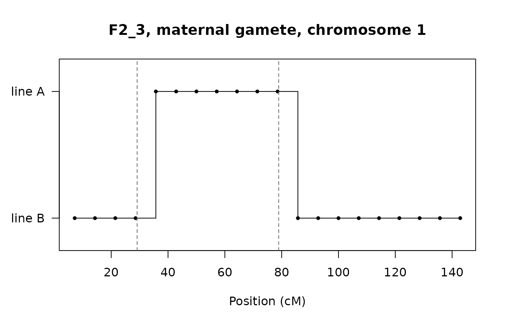
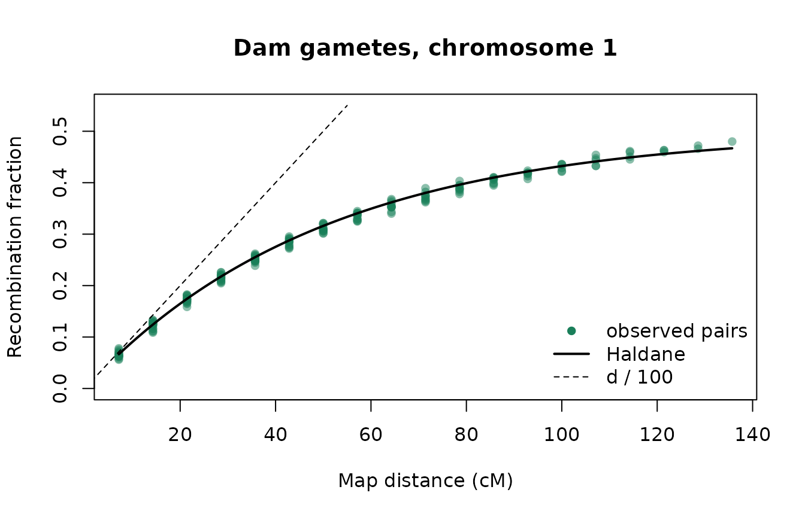

# Recombination and genetic maps

Every offspring
[`add_offspring()`](https://austin-putz.github.io/tidybreed/reference/add_offspring.md)
creates receives one gamete from each parent, and each gamete is a
recombined copy of that parent’s two haplotypes. Linkage disequilibrium,
the decay of QTL-marker associations, and the response to genomic
selection all follow from how those crossovers are drawn. This article
explains the model, shows where the genetic map comes from, and then
**checks the simulated recombination against the map**, so you can see
for yourself that the rates are right.

``` r

library(tidybreed)
library(dplyr)
```

## The model

For each gamete and each chromosome,
[`add_offspring()`](https://austin-putz.github.io/tidybreed/reference/add_offspring.md):

1.  reads the genetic positions (`pos_cM`) of the chromosome’s loci from
    the map of the **parent making the gamete**;
2.  draws the number of crossovers from a Poisson distribution with mean
    `L / 100`, where `L` is the chromosome’s genetic length in cM (the
    last locus’s `pos_cM`), i.e. its length in Morgans;
3.  picks the homolog the gamete starts on, 50/50;
4.  places the crossovers uniformly on `[0, L]`; each locus takes the
    homolog reached after the crossovers to its left, switching at every
    one.

Crossovers that fall independently and uniformly are the **Haldane**
model: there is no crossover interference, and two loci `d` cM apart
recombine with probability

``` math
r = \tfrac{1}{2}\left(1 - e^{-2d/100}\right).
```

At short distances `r` is about `d / 100`; at long distances it
approaches `1/2`, as for loci on different chromosomes. The same
algorithm exists in C++ (used by default) and in R
(`options(tidybreed.kernel = "r")`), and they give bit-identical output
for a given seed.

Every gamete draws from its own random stream, keyed on the base seed,
the offspring and the parent, so a seeded call gives the same offspring
whatever `batch_size` is.

## Where the map comes from

[`define_genome()`](https://austin-putz.github.io/tidybreed/reference/define_genome.md)
places loci evenly along each chromosome (`pos_bp`) and gives each a
genetic position `pos_cM = pos_bp / 1e6 * cM_per_Mb`. The rate can be
one number for the whole genome or one per chromosome:

``` r

set.seed(2026)
pop <- open_pop(pop_name = "recombination", db_name = ":memory:") |>
  define_genome(n_loci = 60, n_chr = 3,
                chr_len_Mb = c(150, 100, 80),
                cM_per_Mb  = c(1, 0.5, 1))
#> duckdb keeps downloaded extensions and secrets in a temporary directory:
#> ℹ /tmp/RtmpoQYuvm/duckdb
#> This is removed when the R session ends.
#> • Extensions are re-downloaded each session.
#> • Secrets are lost.
#> ℹ Run duckdb(shared_home = TRUE) (or create ~/.duckdb) to keep them (suitable for most users).
#> ℹ Run duckdb(shared_home = FALSE) to accept the temporary directory (and silence this message).
#> ℹ See ?duckdb_storage for details and alternatives.
#> Opened in-memory population 'recombination'
#> 
#> Defined genome: 60 loci across 3 chromosomes | chr lengths (Mb): 1:150, 2:100, 3:80
#>   Tables written: genome_meta, genome_map, ind_haplotype, ind_genotype, ind_crossover, chr_inheritance, chr_recombination, genome_effects, genome_effect_members, genome_effect_member_origins
#>   Views created: genome_effect_terms, genome_effect_loci

# genome_map holds the genetic positions, genome_meta the chromosome of each locus
map <- get_table(pop, "genome_map") |>
  select(locus_id, pos_cM) |>
  collect() |>
  inner_join(get_table(pop, "genome_meta") |> select(locus_id, chr_name) |> collect(),
             by = "locus_id")

map |>
  group_by(chr_name) |>
  summarise(n_loci = n(), first_cM = min(pos_cM), last_cM = max(pos_cM))
#> # A tibble: 3 × 4
#>   chr_name n_loci first_cM last_cM
#>   <chr>     <int>    <dbl>   <dbl>
#> 1 1            20     7.14   143. 
#> 2 2            20     2.38    47.6
#> 3 3            20     3.81    76.2
```

Chromosome 2 is 100 Mb but only 0.5 cM/Mb, so it is about 50 cM long and
averages half a crossover per meiosis. Loci are never placed at the
chromosome ends, so the length that matters, the last locus’s position,
is a little shorter than `chr_len_Mb * cM_per_Mb`. A crossover beyond
the last locus could not change any allele, so this costs nothing.

`genome_map` also has `sex` and `line_name` columns. A gamete uses, per
locus, the most specific row that matches its producing parent: (sex and
line), then sex, then line, then the default map. This is how a
sex-specific map (female maps are usually longer) or a line-specific map
is applied.
[`define_genome()`](https://austin-putz.github.io/tidybreed/reference/define_genome.md)
writes only the default map, and there is not yet an exported function
to write the others.

## Making recombination visible

Recombination is only visible where a parent’s two homologs differ. A
cross between two lines makes every locus informative: line A sires
mated to line B dams give F1 animals with one A copy and one B copy
everywhere, and every allele in `ind_haplotype` carries its
`line_origin`. In an F1 gamete, each switch from A to B (or back) is a
recombination, whatever the alleles are.

Two chromosome rules make the example richer. Chromosome 3 is an X:
males inherit only the dam’s copy. Chromosome 2 does not recombine in
males (achiasmy, as in *Drosophila* males).

``` r

pop <- pop |>
  define_chromosome("3", offspring_sex = "M", from_parent_1 = 0, from_parent_2 = 1) |>
  define_chromosome("2", parent_sex = "M", recombines = FALSE) |>
  define_founder_haplotypes(n_haplotypes = 10, line_name = "A") |>
  define_founder_haplotypes(n_haplotypes = 10, line_name = "B")
#> Defined chr_inheritance rule for '3' (offspring_sex=M, line_name=NULL): from_parent_1=0, from_parent_2=1
#> Defined chr_recombination rule for '2' (parent_sex=M, line_name=NULL): recombines=FALSE
#> Generating 10 founder haplotypes (method = "uniform")...
#>   Created founder_haplotypes for line 'A' (10 haplotypes x 60 loci)
#> Generating 10 founder haplotypes (method = "uniform")...
#>   Created founder_haplotypes for line 'B' (10 haplotypes x 60 loci)

pop <- pop |>
  get_table("founder_haplotypes") |>
  filter(line_name == "A") |>
  add_founders(n_males = 5, n_females = 0, line_name = "A")
#> Added 5 founders (5 males, 0 females) to line 'A'
pop <- pop |>
  get_table("founder_haplotypes") |>
  filter(line_name == "B") |>
  add_founders(n_males = 0, n_females = 5, line_name = "B")
#> Added 5 founders (0 males, 5 females) to line 'B'

# F1: A sires x B dams
f1 <- tibble(id_parent_1 = paste0("A_", rep(1:5, 4)),
             id_parent_2 = paste0("B_", rep(1:5, 4)),
             sex = rep(c("M", "F"), 10), line_name = "F1")
pop <- add_offspring(pop, f1, seed = 1)
#> Added 20 offspring (base_seed = 1)

# F2: F1 males x F1 females, recording every crossover
n_f2 <- 1500
f1_ids <- get_table(pop, "ind_meta") |> filter(line_name == "F1") |> collect()
f2 <- tibble(
  id_parent_1 = rep(f1_ids$id_ind[f1_ids$sex == "M"], length.out = n_f2),
  id_parent_2 = rep(f1_ids$id_ind[f1_ids$sex == "F"], length.out = n_f2),
  sex = rep(c("M", "F"), length.out = n_f2), line_name = "F2")
pop <- add_offspring(pop, f2, seed = 2, store_crossovers = TRUE)
#> Added 1500 offspring (base_seed = 2)
```

Here is one F2 animal’s maternal gamete on chromosome 1: the line each
allele came from, with the crossovers recorded in `ind_crossover` as
dashed lines.

``` r

f2_haps <- get_table(pop, "ind_haplotype") |>
  filter(substr(id_ind, 1, 3) == "F2_") |>
  select(id_ind, parent_origin, locus_id, line_origin) |>
  collect() |>
  inner_join(map, by = "locus_id")

one <- f2_haps |>
  filter(id_ind == "F2_3", parent_origin == 2, chr_name == "1")
xo <- get_table(pop, "ind_crossover") |>
  filter(id_ind == "F2_3", parent_origin == 2, chr_name == "1") |>
  collect()

plot(one$pos_cM, ifelse(one$line_origin == "A", 1, 0), type = "s",
     yaxt = "n", ylim = c(-0.2, 1.2), xlab = "Position (cM)", ylab = "",
     main = "F2_3, maternal gamete, chromosome 1")
points(one$pos_cM, ifelse(one$line_origin == "A", 1, 0), pch = 16, cex = 0.7)
axis(2, at = c(0, 1), labels = c("line B", "line A"), las = 1)
abline(v = xo$pos_cM, lty = 2, col = "grey40")
```



The points are the loci. The line changes at the first locus past each
crossover, because only loci are observed: a step falls between two loci
exactly when an odd number of crossovers lies between them. Two
crossovers between the same pair of loci leave no trace, which is why
the recombination fraction is below `d / 100` at longer distances.

## Checking the rates against the map

For every pair of loci on a chromosome, the observed recombination
fraction is the share of gametes whose line changes between the two
loci. Plotted against the map distance it should follow the Haldane
curve.

``` r

# Recombination fraction for every pair of loci on one chromosome, from the
# gametes of one parent sex (parent_origin 1 = sire, 2 = dam)
pair_rates <- function(haps, chr, origin) {
  h <- haps |>
    filter(chr_name == chr, parent_origin == origin) |>
    arrange(id_ind, locus_id)
  pos <- sort(unique(h$pos_cM))
  W <- matrix(h$line_origin == "A", ncol = length(pos), byrow = TRUE)
  pairs <- t(combn(length(pos), 2))
  data.frame(
    d     = pos[pairs[, 2]] - pos[pairs[, 1]],
    r_obs = colMeans(W[, pairs[, 1]] != W[, pairs[, 2]]),
    n     = nrow(W)
  )
}

haldane <- function(d) 0.5 * (1 - exp(-2 * d / 100))

dam_chr1 <- pair_rates(f2_haps, "1", 2)
plot(dam_chr1$d, dam_chr1$r_obs, pch = 16, col = "#1a7f5a80",
     xlab = "Map distance (cM)", ylab = "Recombination fraction",
     main = "Dam gametes, chromosome 1", ylim = c(0, 0.55))
curve(haldane(x), add = TRUE, lwd = 2)
curve(x / 100, from = 0, to = 55, add = TRUE, lty = 2)
legend("bottomright", c("observed pairs", "Haldane", "d / 100"),
       pch = c(16, NA, NA), lty = c(NA, 1, 2), lwd = c(NA, 2, 1),
       col = c("#1a7f5a", "black", "black"), bty = "n")
```



The points sit on the Haldane curve and peel away from the `d / 100`
line as double crossovers become common. A standardised residual,
`z = (r_obs - r) / sqrt(r (1 - r) / n)`, puts every pair on one scale; a
correct model gives values within a few units of 0:

``` r

z_summary <- function(x) {
  r <- haldane(x$d)
  z <- (x$r_obs - r) / sqrt(r * (1 - r) / x$n)
  c(pairs = nrow(x), max_abs_z = round(max(abs(z)), 2))
}
rbind(
  "dam, chr 1 (1 cM/Mb)"   = z_summary(dam_chr1),
  "sire, chr 1 (1 cM/Mb)"  = z_summary(pair_rates(f2_haps, "1", 1)),
  "dam, chr 2 (0.5 cM/Mb)" = z_summary(pair_rates(f2_haps, "2", 2)),
  "dam, X"                 = z_summary(pair_rates(f2_haps, "3", 2))
)
#>                        pairs max_abs_z
#> dam, chr 1 (1 cM/Mb)     190      1.83
#> sire, chr 1 (1 cM/Mb)    190      2.50
#> dam, chr 2 (0.5 cM/Mb)   190      2.58
#> dam, X                   190      2.52
```

### Crossover counts

The number of crossovers a gamete has on a chromosome should be Poisson
with mean `L / 100`. `ind_crossover` has one row per crossover; a gamete
with none has no row, so the zeros are added back:

``` r

xo_counts <- get_table(pop, "ind_crossover") |>
  filter(substr(id_ind, 1, 3) == "F2_", parent_origin == 2, chr_name == "1") |>
  count(id_ind) |>
  collect()
n_xo <- c(xo_counts$n, rep(0L, n_f2 - nrow(xo_counts)))

L1 <- max(map$pos_cM[map$chr_name == "1"])
k  <- 0:max(n_xo)
rbind(observed = tabulate(n_xo + 1L, nbins = length(k)),
      expected = round(n_f2 * dpois(k, L1 / 100), 1)) |>
  `colnames<-`(k)
#>              0     1     2     3    4    5   6
#> observed 364.0 531.0 345.0 168.0 63.0 25.0 4.0
#> expected 359.5 513.5 366.8 174.7 62.4 17.8 4.2
c(mean = mean(n_xo), variance = var(n_xo), expected = L1 / 100)
#>     mean variance expected 
#> 1.417333 1.458805 1.428571
```

## Sex-dependent rules

The chromosome rules change what a parent passes on:

- **Achiasmy.** Chromosome 2 does not recombine in males, so an F1 sire
  passes one of his two chromosome 2 copies whole: every pair of loci
  has recombination fraction 0, while the dams’ gametes follow the map.
- **The X.** An F1 male has a single X, from his line B dam. He passes
  it unchanged to every daughter and nothing to his sons; the F1
  females’ X recombines at the map rate (the “dam, X” row above).

``` r

sire_chr2 <- pair_rates(f2_haps, "2", 1)
c(max_r_sire_chr2 = max(sire_chr2$r_obs))
#> max_r_sire_chr2 
#>               0

pat_x <- f2_haps |>
  filter(chr_name == "3", parent_origin == 1) |>
  inner_join(get_table(pop, "ind_meta") |> select(id_ind, sex) |> collect(),
             by = "id_ind")
table(offspring_sex = pat_x$sex, line_origin = pat_x$line_origin)
#>              line_origin
#> offspring_sex     B
#>             F 15000
```

Only daughters carry a paternal X, and it is always line B.

## Assumptions and limits

- **No crossover interference.** Crossovers are independent (Haldane).
  Real meiosis spaces crossovers apart and usually forces at least one
  per chromosome pair, which the Kosambi map function approximates. The
  Haldane model therefore slightly overstates double recombinants over
  short distances. For simulating linkage disequilibrium and selection
  response this is the standard choice.
- **The chromosome ends at its last locus.** The crossover count uses
  the last locus’s position, not `chr_len_Mb * cM_per_Mb`. Alleles are
  unaffected, but crossover counts read from `ind_crossover` are those
  of the mapped segment.
- **A chromosome at most 3000 cM long.** Longer is refused as almost
  certainly a units error.
- **Sex- and line-specific maps** are honoured by
  [`add_offspring()`](https://austin-putz.github.io/tidybreed/reference/add_offspring.md),
  but
  [`define_genome()`](https://austin-putz.github.io/tidybreed/reference/define_genome.md)
  writes only the default map.

The checks in this article are run, with fixed seeds and larger samples,
in the package’s test suite
(`tests/testthat/test-recombination_rates.R`), together with a
male-specific map twice the default length.
